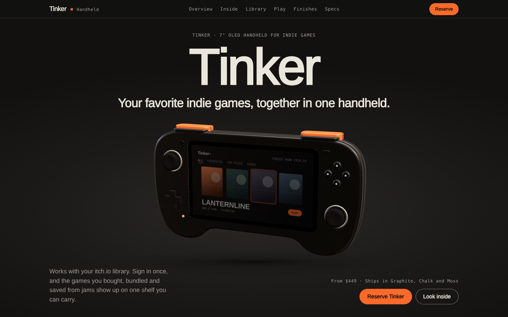
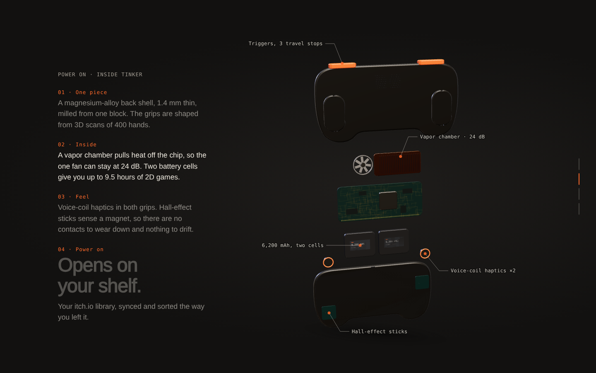
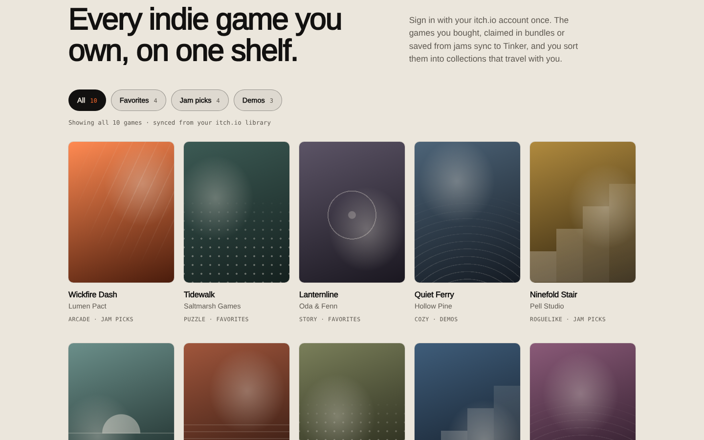
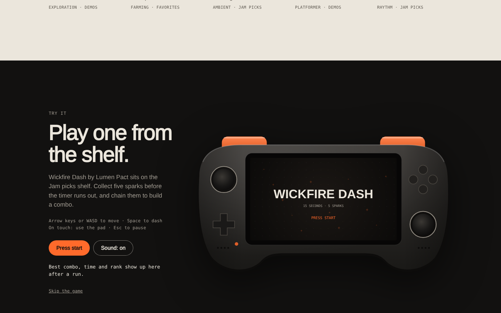
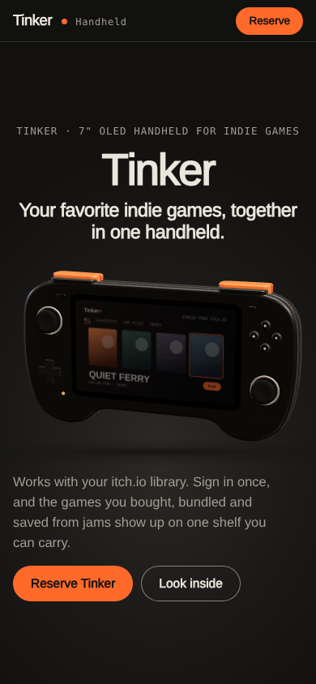

# Tinker



A launch page for a handheld made for indie games. Concept project, 2026. Design and front-end by [Victor Cavalcante](https://victorvk.com).

**Live demo:** [victorvk.com/lab/tinker](https://victorvk.com/lab/tinker/) (best on desktop, scroll slowly)

> Tinker is a fictional product and a design concept. It is not affiliated with or endorsed by itch.io.

## The brief

I gave myself a brief: build a product launch page with the craft and pacing of a top-tier hardware launch, for a fictional 7-inch OLED handheld. Rules I set: one self-contained HTML file, no photos or stock renders, and every visual made in code (three.js, canvas, SVG, CSS). It also had to work on a 390px phone, with a keyboard, and with reduced motion turned on.

## The idea

Your favorite indie games come from small creators and end up spread across downloads and folders. Tinker works with your itch.io library: sign in once and the games you own show up on one shelf you can sort into collections.

Every section of the page answers one question a buyer would ask, in order: what is it, why does it matter, what's inside, what are the numbers, where do my games go, what does it feel like, which one do I pick, what does it cost.

## What's on the page

| | |
|---|---|
|  | **Teardown.** A pinned, scroll-scrubbed chapter. Every layer lifts out along depth, then the stack spreads open with labels tracking each part. Scroll back and it closes. |
|  | **Library.** Ten invented games from invented studios, filterable by Favorites, Jam picks and Demos. Covers drawn in CSS. |
|  | **Play one.** *Wickfire Dash* runs on the device screen, with keyboard or a touch pad. |

Also: a 3D finishes picker (drag or arrow keys, three colorways) and a reserve form with inline validation. No data is sent anywhere.

## How it's built

- **One HTML file**, about 115 KB. No images, no 3D model files.
- **three.js** for the device: extruded curves, physical materials, a procedural studio environment, rim lighting and a contact shadow. The screen is a canvas texture showing the shelf.
- **GSAP + ScrollTrigger** pin the teardown and turn scroll into a 0–1 progress value. **Lenis** smooths the scroll on desktop.
- **Canvas 2D and SVG** for the mini-game, diagrams and the SVG fallback when WebGL isn't available.
- One easing language: a strong ease-out `cubic-bezier(.16, 1, .3, 1)` for reveals and a symmetric in-out for state changes.

### Testing the teardown

A script steps the explode value in 1,000 increments and checks every part's bounding box against every part in other layers. It fails if one part moves into another. A second check projects each part to the screen at 1440×900 and 390×844 and fails if two parts overlap or a callout leaves the viewport. Both pass with zero problems.

## Accessibility and performance

- Reduced motion swaps the teardown for pre-rendered stills and turns off smooth scroll and ambient loops.
- Visible focus rings everywhere. The game and the 3D viewer are labeled for screen readers.
- Animations only touch `transform` and `opacity`. WebGL pixel ratio is capped, rendering stops when no 3D chapter is on screen, three.js loads lazily, and a lost GL context falls back to SVG.



## Run it

No build step. Open `index.html` in a browser, or serve the folder:

```bash
python3 -m http.server 8000   # open http://localhost:8000
```

## What I'd do next

- Test with real users whether moving the library above the teardown changes reserve clicks.
- Replace the procedural model with a proper glTF and baked lighting.
- Profile on mid-range Android hardware and tune the teardown's draw calls.

## License

The code is MIT. The Tinker name, product design, visual identity and the invented games and studios are © Victor Cavalcante, all rights reserved. three.js and Lenis are MIT; GSAP has its own [license](https://gsap.com/standard-license/).
